 
 

&nbsp;
&nbsp;

 
 

 
 

 
 

 
 

 
 

Designing and building <a href="https://formetry.dev">formetry.dev</a>. Founder and lead developer of <a href="https://counterstrike2.pl/">CS2 Polska</a>. Developer of <a href="https://z-scripts.com/">Z Scripts</a>.

